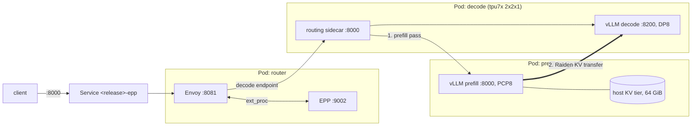

# Qwen3.5-397B-A17B-FP8 on Ironwood (tpu7x) with vLLM TorchTPU: llm-d prefill/decode disaggregation (1P1D), AgentX benchmark

This recipe serves `Qwen/Qwen3.5-397B-A17B-FP8` with the vLLM **TorchTPU**
backend on GKE using [llm-d](https://github.com/llm-d) prefill/decode (P/D)
disaggregation, and benchmarks it with the InferenceX **AgentX**
agentic-coding workload.

- **Topology (1P1D)**: one prefill engine and one decode engine. Each engine
  runs on its own single-host tpu7x `2x2x1` slice (4 chips, 8 TPU devices).
  - Prefill: prefill context parallel 8 (PCP8), prefix caching on, plus a
    64 GiB host DRAM KV-cache tier (KV offload).
  - Decode: data parallel 8 (DP8), prefix caching on.
- **KV transfer**: the TorchTPU Raiden connector (`TPURaidenConnector`) moves
  the KV cache from prefill to decode. On prefill it runs inside
  `TPUMultiConnector` next to `TPURaidenOffloadingConnector`, which keeps
  prefix-cache blocks evicted from HBM in host memory.
- **Router**: the llm-d Endpoint Picker (EPP) in **standalone** mode. An
  Envoy proxy runs in the same pod as the EPP and is the model endpoint. The
  EPP finds the engines by pod label, so no Gateway API, InferencePool CRDs,
  or cloud load balancer are needed.
- **Client**: the InferenceX AIPerf build running the `inferencex-agentx-mvp`
  scenario on the
  [`semianalysisai/cc-traces-weka-062126-256k`](https://huggingface.co/datasets/semianalysisai/cc-traces-weka-062126-256k)
  traces (multi-turn coding sessions with roughly 90k-104k input tokens and
  about 900 output tokens per request), streaming, at concurrency 32 for
  3600 s after a per-lane warmup.



For each request, the EPP picks a prefill engine and a decode engine. Envoy
sends the request to the routing sidecar in the decode pod. The sidecar runs
the prompt on the prefill engine, which sends the KV cache to decode over
Raiden, and then the decode engine generates the response.

## Versions

This recipe was validated with:

| Component | Image |
| --- | --- |
| vLLM TorchTPU (both engines) | `vllm/vllm-torchtpu:v0.29.0` |
| llm-d Endpoint Picker | `ghcr.io/llm-d/llm-d-router-endpoint-picker:v0.11.0` |
| llm-d routing sidecar | `ghcr.io/llm-d/llm-d-router-disagg-sidecar:v0.11.0` |
| Envoy | `docker.io/envoyproxy/envoy:distroless-v1.33.2` |
| InferenceX AgentX client | `us-central1-docker.pkg.dev/cloud-tpu-inference-test/inferencex/inferencex-agentx@sha256:7cbad0266e9a599e37a00d7ba533acc17732064ab659db5d4084f3bff19361b6` |

Notes on the images:

- The vLLM TorchTPU image defaults to the public `vllm/vllm-torchtpu:v0.29.0`
  release from Docker Hub. Override `engine.image` to use a newer release or
  a mirror in your own registry. Use v0.29.0 or later; older builds lack the
  prefill context parallel, Raiden KV transfer, and KV offload support this
  recipe needs.
- The engines download the weights from Hugging Face to their own data disk.
  The vLLM TorchTPU images do not include the Run:ai model streamer, so
  `--load-format=runai_streamer` from a GCS bucket does not work with them
  as-is.
- The InferenceX AgentX client image must provide the InferenceX AIPerf build
  under `/root/aiperf-venv`. Replace `client.image` with a copy your cluster
  can pull.

## Prerequisites

- A GKE cluster with **two free tpu7x `2x2x1` nodes** and a CPU node pool for
  the router and the client. You can create the cluster with
  [XPK](https://github.com/AI-Hypercomputer/xpk).
- The Compute Engine persistent disk CSI driver (enabled by default on GKE),
  for one 600 GiB Hyperdisk Balanced volume per engine.
- Egress from the cluster to Hugging Face and `ghcr.io`.
- A Hugging Face token with read access to the model and the dataset.

Placeholders in `values.yaml`:

| Value | Default | Set it to |
| --- | --- | --- |
| `hf_token` | `""` | Your Hugging Face token. Pass it with `--set`. |
| `reservation` | `""` | Optional: your tpu7x reservation name. |
| `kueue.queue_name`, `kueue.priority_class` | `""` | Optional: your Kueue LocalQueue and priority class, if the cluster uses Kueue. |
| `storage_class` | `""` | Optional: an existing StorageClass for the data disks. If empty, the chart creates a Hyperdisk Balanced StorageClass named `<release>-hyperdisk-balanced`. |
| `engine.image`, `client.image` | see [Versions](#versions) | Images your cluster can pull. |

## Deploy

### Configure kubectl to communicate with your cluster

```
gcloud container clusters get-credentials ${CLUSTER_NAME} --location=${LOCATION}
```

### Generate a new Hugging Face token if you don't already have one

On the Hugging Face website, create an account if necessary, and go to Your
Profile > Settings > Access Tokens. Select Create new token. Specify a name of
your choice and a role with at least Read permissions. Select Generate a
token, follow the prompts, and save your token.

Also make sure that your account has access to the model and the dataset on
Hugging Face.

### Install the chart

In this directory, run:

```
helm install ${RUN_NAME} . --set hf_token=${HF_TOKEN}
```

Add `--set reservation=...`, `--set kueue.queue_name=...` and
`--set kueue.priority_class=...` if your cluster needs them.

The chart creates a prefill Deployment, a decode Deployment, a router
Deployment, the `${RUN_NAME}-epp` Service, and a client Job. Every object is
labelled `app.kubernetes.io/instance=${RUN_NAME}`:

```
kubectl get pods -l app.kubernetes.io/instance=${RUN_NAME}
```

The router pod is ready within a minute. Each engine downloads about 400 GB
of weights and then compiles, which takes about 30 minutes. At the end of the
startup each engine logs:

```
$ kubectl logs -f -c vllm-torchtpu deploy/${RUN_NAME}-prefill

(APIServer pid=1) INFO:     Application startup complete.
```

The prefill engine also logs that each of its 8 workers registered with the
host KV tier. If these lines are missing, KV offload did not start:

```
$ kubectl logs deploy/${RUN_NAME}-prefill -c vllm-torchtpu | grep 'registered with offload controller'

TPURaidenOffloadingConnector: rank 0 registered with offload controller at 127.0.0.1:47800 (2184 host kernel blocks)
```

> [!IMPORTANT]
> Send traffic only to the `${RUN_NAME}-epp` Service. A request sent
> directly to the decode engine (port 8200) or to the prefill engine skips
> P/D without any error.

## Verify P/D and the KV transfer

A fluent HTTP 200 response does not prove that P/D happened. Run these checks
before you trust a benchmark.

1.  Send a request through the router:

    ```
    kubectl port-forward svc/${RUN_NAME}-epp 8000:8000 &
    curl -s localhost:8000/v1/models
    curl -s localhost:8000/v1/chat/completions -H 'Content-Type: application/json' -d '{
      "model": "Qwen/Qwen3.5-397B-A17B-FP8",
      "messages": [{"role": "user", "content": "Name three primary colors."}],
      "max_tokens": 200,
      "chat_template_kwargs": {"enable_thinking": false}
    }'
    ```

    With thinking on (the model default), short `max_tokens` budgets can be
    spent entirely on `reasoning_content`, leaving `content` empty.

2.  Confirm the request path. The Envoy access log shows each request and
    the endpoint the EPP chose: a `POST` must go to the decode pod IP on port
    8000 (the routing sidecar). The prefill engine log then shows the prefill
    pass as a `POST` that comes from the decode pod IP:

    ```
    kubectl get pods -o wide -l app.kubernetes.io/instance=${RUN_NAME}
    kubectl logs deploy/${RUN_NAME}-epp -c envoy | grep POST | tail -3
    kubectl logs deploy/${RUN_NAME}-prefill -c vllm-torchtpu | grep 'POST /v1/chat/completions' | tail -3
    ```

3.  Confirm that Raiden moved the KV cache. For each request, the prefill
    engine logs `raiden_stage3_sender_complete` once per sender rank (8 lines)
    and the decode engine logs one `raiden_stage3_receiver_complete`. Both
    carry the same request `uuid`:

    ```
    kubectl logs deploy/${RUN_NAME}-prefill -c vllm-torchtpu | grep raiden_stage3_sender_complete | tail -8
    kubectl logs deploy/${RUN_NAME}-decode -c vllm-torchtpu | grep raiden_stage3_receiver_complete | tail -1
    ```

    Do not use `Num successful transfers` from the `KV Transfer metrics:` log
    line, or `usage.prompt_tokens_details.cached_tokens` in the response.
    Neither counts Raiden transfers.

4.  Optional: confirm that P/D output matches local computation. Send the
    same request at `temperature: 0` through the router and directly to the
    decode engine (which then computes the prompt itself). The two responses
    must be identical:

    ```
    kubectl port-forward deploy/${RUN_NAME}-decode 8200:8200 &
    # Repeat the request from step 1 against localhost:8200 with "temperature": 0,
    # and compare it with the same request sent to localhost:8000.
    ```

    Use the direct decode port only for this check; it skips P/D.

5.  Optional: check prefix-cache hits on the prefill engine. HBM hits are
    counted in `vllm:prefix_cache_hits_total`. Hits served from the host KV
    tier are counted in `vllm:external_prefix_cache_hits_total`:

    ```
    kubectl port-forward deploy/${RUN_NAME}-prefill 8001:8000 &
    curl -s localhost:8001/metrics | grep -E '^vllm:(external_)?prefix_cache_hits_total'
    ```

    The host tier only serves blocks that HBM has evicted. The prefill HBM
    KV pool holds about 13.8M tokens, so a workload whose shared prefixes fit
    in HBM, such as AgentX at concurrency 32, can run without any host-tier
    hits. Prefix hits come in whole 6144-token blocks (`--block-size=768`
    times PCP8), so prompts shorter than 6144 tokens never hit.

## Run the benchmark

The client Job waits until the router serves a chat completion, warms up each
lane, runs the 3600 s measurement window, and prints an AIPerf summary
(request and error counts, token throughput, time to first token, and
inter-token latency):

```
kubectl logs -f job/${RUN_NAME}-client
```

The full AIPerf export is in `/tmp/aiperf_results` in the client container.

### Customize the benchmark

All settings live in `values.yaml`:

- `client.concurrency`, `client.benchmark_duration_s`,
  `client.warmup_requests_per_lane`: the AgentX load. Set
  `client.enabled=false` to deploy only the serving stack.
- `engine.env` / `engine.args`: TorchTPU settings and `vllm serve` flags
  shared by both engines. `prefill.*` and `decode.*` hold the role-specific
  parallelism, ports, and KV connector settings.
- `files/epp-config.yaml`: the EPP scheduling profiles. The default sends
  every request through P/D.

Both engines need `--enable-auto-tool-choice --tool-call-parser=qwen3_coder
--reasoning-parser=qwen3`. Without them, requests that send `tools` with
`tool_choice: "auto"` get HTTP 400. The reasoning parser moves the model's
thinking text out of `content` into `reasoning_content`.

## Troubleshooting

| Symptom | Cause and fix |
| --- | --- |
| HTTP 200 but no `raiden_stage3_*` lines | The request did not go through `${RUN_NAME}-epp`, or the EPP found no prefill endpoint. Use the router Service and check the EPP log. |
| Prefill exits with `Stage-3 PCP page geometry requires page_tokens divisible by cp_kv_cache_interleave_size` | `--block-size` was removed or changed. Keep a multiple of 256 (the default is 768). |
| Engine `OOMKilled` while loading weights | `engine.memory` is too low. Weight loading peaks near 500 GiB, and prefill adds the 64 GiB host KV tier. |
| Router pod `1/2`, Envoy restarts with `Couldn't find match for argument` | Envoy rejects `--flag=value`. Keep each flag and value as separate `args` items. |
| Decode receives only part of the KV cache | `TPU_RAIDEN_TRANSFER_PARALLELISM` must be 8 on decode too. It is the number of prefill sender ranks. |
| Pods exist but stay `SchedulingGated` | Kueue has not admitted them. Check `kubectl get workloads` and the queue settings. |

The following log lines are harmless: `Unable to poll TPU GCE Metadata`,
`Triton is installed but 0 active driver(s) found`, and `Raiden bounded host
staging unavailable ... falling back`.

## Cleanup

The engines keep running after the benchmark finishes. Remove everything the
chart created, including the data disks and the StorageClass, with:

```
helm uninstall ${RUN_NAME}
```

The chart also creates a namespaced Role and RoleBinding that let the EPP
list and watch pods. Deleting them needs permission to delete Roles and
RoleBindings in the namespace. If `helm uninstall` fails with `Forbidden` on
those two objects, ask someone with that permission to remove the Role and
RoleBinding named `${RUN_NAME}-epp`; everything else is already gone.
